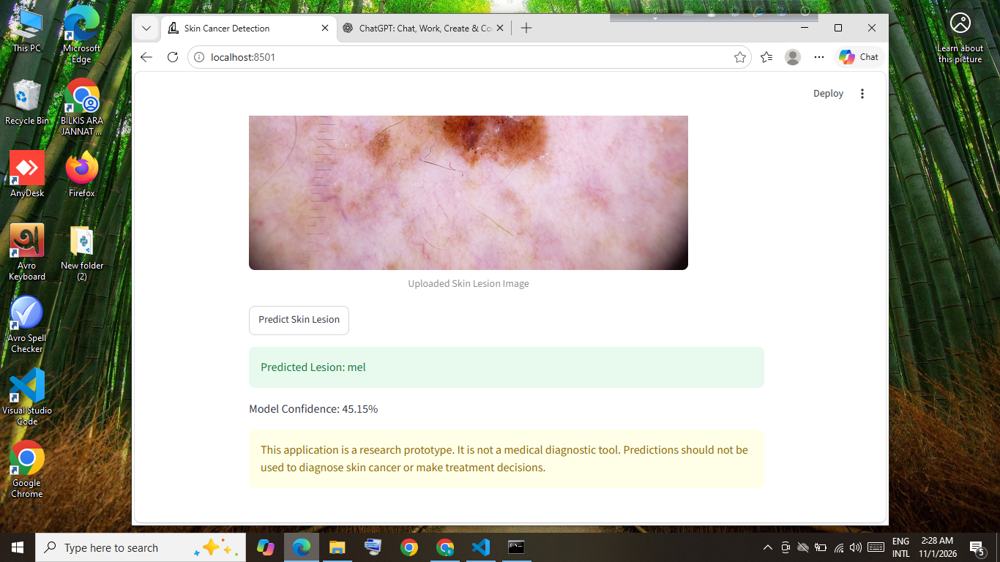

# Skin Cancer Detection Using Hybrid CNN-ViT

## Project Overview

This project uses a Hybrid CNN-ViT deep learning model to classify seven types of skin lesions using the HAM10000 dataset.

## Dataset

* Dataset: HAM10000
* Total Images: 10,015
* Training Images: 6,981
* Validation Images: 1,532
* Testing Images: 1,502

## Seven Skin Lesion Classes

* akiec
* bcc
* bkl
* df
* mel
* nv
* vasc

## Model Architecture

* CNN Backbone: ResNet18
* Transformer Encoder: 2 layers
* Classification: 7 skin lesion classes

## Model Performance

* Test Accuracy: 64.38%
* Macro F1 Score: 0.4435
* Balanced Accuracy: 51.46%

## Technologies

Python, PyTorch, Torchvision, Streamlit, NumPy, Pandas, Scikit-learn and Pillow.

## Streamlit Application

The application allows users to upload skin lesion images and view model predictions.

## Example Prediction

* Image ID: ISIC_0030443
* Actual Label: Melanoma (mel)
* Predicted Label: Melanoma (mel)
* Model Confidence: 45.15%

## Running the Application

Install dependencies:

`python -m pip install -r requirements.txt`

Place the trained model file `hybrid_cnn_vit_best.pth` in the project folder.

Run the application:

`python -m streamlit run app.py`

Note: The trained model weights are not included in this GitHub repository.

## Future Improvements

* Improve minority-class classification
* Add Grad-CAM visualizations
* Evaluate additional datasets
* Improve model performance

## Disclaimer

This application is an academic research prototype. It is not a medical diagnostic tool and must not be used for diagnosis or treatment decisions.
